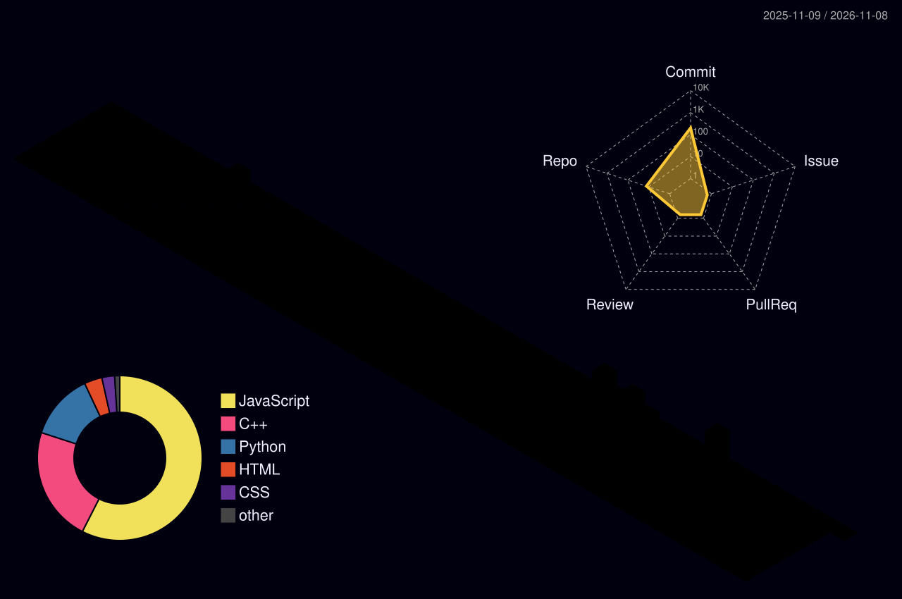
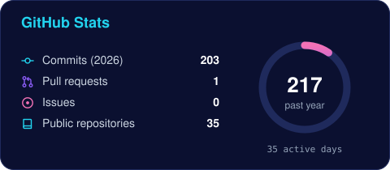
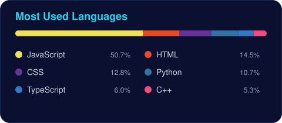

<div align="center">



<a href="https://pranjal-panwar.netlify.app/"></a>
<a href="https://www.linkedin.com/in/pranjal-panwar-7a84b2257"></a>


</div>

### `> whoami`

**Final-year ENTC student and full-stack developer** building practical web products with clean APIs, thoughtful interfaces, and AI-ready workflows.

```ts
const pranjal = {
  base:        "Pune, India 📍",
  building:    ["MERN apps", "REST APIs", "AI-integrated web apps"],
  sharpening:  ["React", "Node.js", "Express", "MongoDB", "Redis"],
  interests:   ["backend systems", "developer-friendly products", "LLMs"],
  openTo:      ["SWE internships", "entry-level roles", "collaborations"],
};
```

<div align="center">






### `> git log --stats`











</div>
